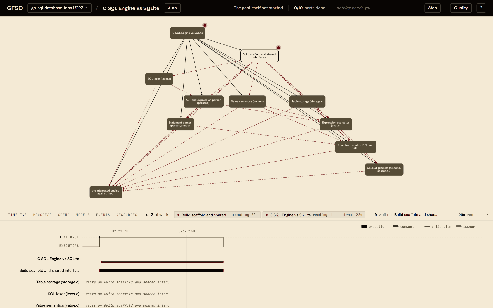
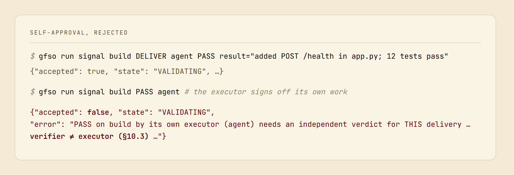
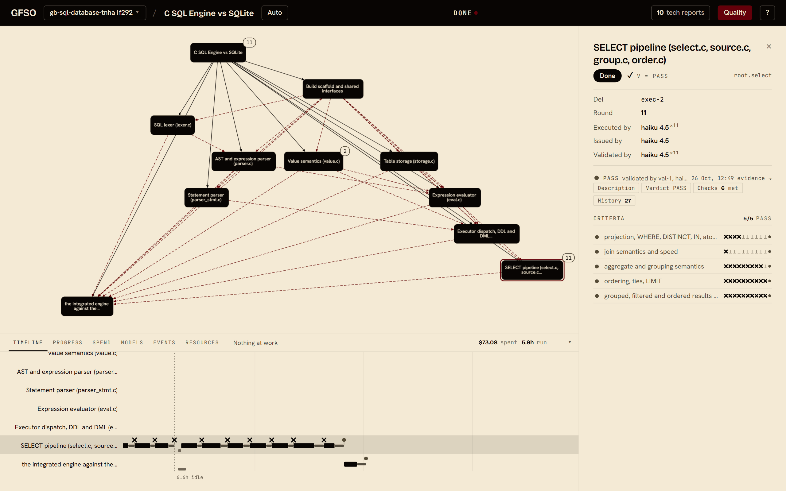
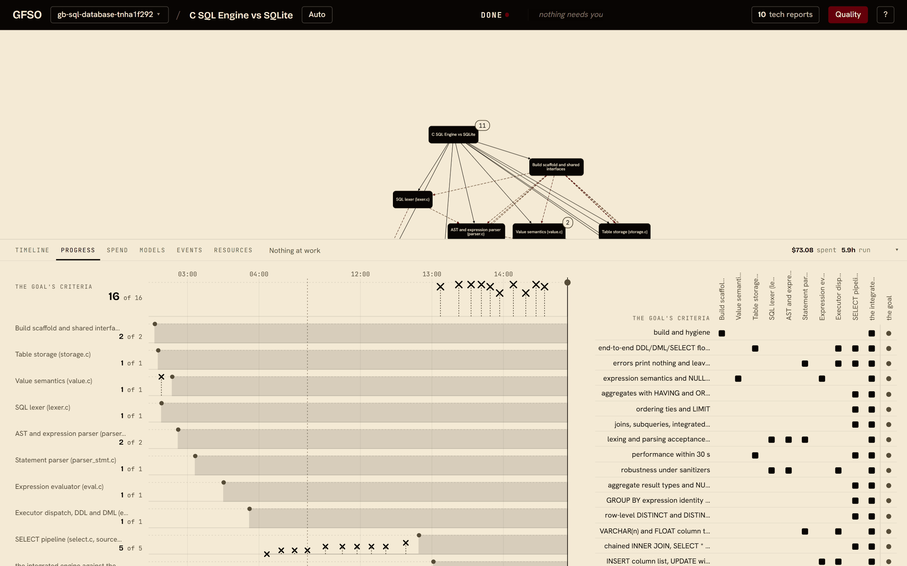

<div align="center">

# GFSO

**Make a plan falsifiable — so when it fails, you know exactly which part was wrong.**



<br>
<sub>A recorded run, replayed in the UI: the goal's parts run in parallel, every session on the timeline below; a part, then the whole, sent back and reworked until its checks pass; the goal delivered. <em>(<code>sql_database</code> · Haiku 4.5, automatic mode — the run behind the table's 100% on the final plan. Midway an engine rule, since removed, stopped it for 6.6 h; it resumed on the fixed build, and the stop is folded out of the timeline.)</em></sub>

</div>

---

**A plan is usually an unfalsifiable story.** It fails, and no one can say which part was wrong — the estimate, the interface, a missed dependency, or the one subtask everyone assumed was trivial. The post-mortem argues. The plan offered nothing to check against.

GFSO turns a decomposition into **pre-registered, separately refutable claims** — every subtask a decidable pass/fail criterion with a named owner, every join between subtasks an explicit claim that *these children, together, make the parent*. Something breaks, and the structure points at the exact false claim and who made it — not at "the project."

Two properties carry that promise, and neither is a design choice you could tune away.

**Failure localizes.** Under a correct decomposition a parent passes exactly when every child passes: `V(parent) = AND(V(children))`. One false leaf cannot hide behind a green parent; the failure pins to the node whose claim broke, at any depth.

**A claim cannot pass on its author's word.** Your agent reports its task done; the engine does not take its word. At every **delegation seam** — and the result handed out of a scope is always one — the verdict is signed by the issuer, never by the executor, over a check that is not the executor's (§10.3), and the engine refuses a `PASS` until a separate validator has run every criterion against the real deliverable — here, live:

<p align="center"></p>

Self-approval is not discouraged. At a seam it is structurally impossible; the one way a self-issued verdict comes to stand there — signed while the node was internal, then made public by a change of Delegation — is named, not hidden (§16.9 exception 15, §16.13). Inside one scope an agent does check its own work — and stakes every bit of it a public delivery carries on the single public verdict at that scope's edge (§10.3).

---

## Measured

One explicit contract per task; nobody is handed tests. Arm A is the default Claude Code agent alone: it writes the code, its own checks and its own report. Under GFSO's automatic mode the same model plays every role and nobody holds the project, in two arms: **plan given** — the system was handed a plan of checks verified beforehand against the benchmark's oracle (for `c_compiler` some probes were derived from named held-out tests) — and **own plan**, where the system writes its plan from the contract. Every arm is scored afterwards on the held-out suite. Rows of the pre-registered build only:

| task · model | the agent alone | GFSO, plan given | GFSO, own plan |
|---|---|---|---|
| `coreutils` · Haiku 4.5 | **done** 3 of 3; held-out 59–73%; 8–13 min, $1.3–2.3 | **done** 2 of 2; 100%; 120–253 min, $21–40 | no verdict (stopped at its spend ceiling) |
| `sql_database` · Haiku 4.5 | **done** 2 of 3; 9% | one NOT DONE after 17 h ($83), two cut at the 9-hour ceiling; on the amended build, two NOT DONE with the root's tree at 54.5% — the given plan's checks all passing there, the system having re-split the plan; on the final plan (Amendment 4), **done** 2 of 2, at 100% (resumed once after an engine fix) and 81.8% (13.47) | no verdict (stopped at its spend ceiling) |
| `c_compiler` · Haiku 4.5 | not done 3 of 3; 12–15% | two cut at the 9-hour ceiling; on the amended build, one stopped after two days with no gain over the starter code (at most 20%), one cut at the ceiling | no verdict (stopped) |
| `c_compiler` · Haiku 5.5 | not done 3 of 3; 74–91%; 19–36 min, $1.4–4.4 | **done** 2 of 2; 98.7%, 99.7%; 71–92 min, $5.5–9.3 | no verdict (stopped) |
| `coreutils` · Haiku 5.5 | **done** 3 of 3; 100% | **done** 2 of 2; 100% | **done** 2 of 2; 100% |
| `sql_database` · Haiku 5.5 | **done** 3 of 3; 100%, 100%, 90.9% | **done** 3 of 3; 100% | **done**; 90.9% |

Over the three tasks and three models of that build, the agent alone claimed "done" 19 times, 8 of them below the held-out suite. The plan-given arm closed 15 roots, 11 at 100% and 4 at 98.7–99.7%; the own-plan arm closed 5, 4 at 100% and one at 90.9%. Each closed root stands on verdicts that ran every check pinned to it, signed by a validator that is not the executor. On the amended build (Amendment 2, the plan-given cells of Haiku 4.5 on `sql_database` and `c_compiler`) no root closed and none claimed done: what stopped them — the given plan's checks passing on trees at 54.5% of the held-out suite, the system re-splitting the given plan, an accepted dispute re-pinning a part's expected output to what the build printed, empty input files in added parts — is in 13.46; the cell was re-run under the pre-registration's Amendment 4, and on its final plan both rows closed, at 100% and 81.8% held-out — the second's gap one `UPDATE … WHERE` defect its checks could not see (13.47). The cells with Sonnet 5.5, the rows pooled from earlier builds, every row's cost and time, and what is not shown are in the pre-registered table's entry of [`EVIDENCE_LOG.md`][evidence] (13.46).

---

## Why those two properties hold

GFSO is not a good design. It is **derived** — from two axioms: that goals are verifiable (A1), and that complex tasks decompose (A2). Fix those, and almost none of the protocol is a choice.

**Why `AND`, and not a weighted score?** Enumerate the sixteen binary aggregations. Require commutativity, associativity, that one failed necessary child fails the parent, and that the result not be constant. `AND` is the sole survivor (§7.2). Localization is not a feature bolted on — it is the only aggregation the axioms allow: under a correct split a passing parent cannot cover a failing leaf, and the failure has exactly one address.

**Why binary acceptance, and not a percentage?** Because A1 already says it: a criterion is a decidable predicate returning pass/fail, and a conjunction of two-valued things is two-valued — the scale is fixed by the axiom, with no appeal to what you do about it (§7.1). The familiar argument — a verdict that maps to no distinct action is not a verdict, so by pigeonhole the scale collapses to two — is the *defense* against a graded scale, not the source, and it rests on there being exactly two actions (a covering claim, not a theorem: finer granularity lives in the tree). There is no "80% done" to shelter in; "in progress" lives in the state machine, not the scale.

**Why trust that you've listed every way it can break?** A decomposition's failures are not collected from experience — they are a basis, complete modulo one covering axiom. Compositional validation is a computation, characterized on two orthogonal axes: the function it evaluates, and the process in time that evaluates it. Split each, and you get **six failure modes with no room for a seventh** (§8.2, §8.8). A study of 216 public post-mortems found 0 that needed one.

**Why can't the agent just game the protocol?** Because the protocol is minimal and incentive-compatible. One handoff runs as a peer-to-peer transaction over 12 signals and 11 states; remove any signal and a specific defect returns. Drop any incentive-critical rule and honesty stops being dominant for one named party, as far as that rule's row closes the behaviour (§11.4, §16.12). Where a deviation is detected and priced and p·cost(undetected defect) > cost(signal) — Prop 8's premise (§16.11) — and outside fifteen named exceptions (§16.9), honesty is made rational by the rules — not asked of people; below that threshold the rules do not make it so.

Two things then come for free. Quality is a five-vector read from the execution trace — all but the post-hoc runs of one term, triggered from outside — so faking a metric by signals means faking the process — though five named dials move a metric unpriced (§15.6). And every decision leaves a record by construction: the way double-entry bookkeeping structurally forbids an unbalanced ledger, GFSO forbids an unrecorded decision (§11.6).

---

## Where the guarantee stops

None of this proves your decomposition is *correct*. It proves only that the plan is checkable, and that failure localizes.

Whether these children truly compose into that parent in the real world, the framework cannot decide — by construction. Two domains with the same formal graph can obey different real laws (Lemma 1), so the axioms do not fix which decomposition is faithful, and no amount of declaring it so grounds it (Lemma 2). That knowledge comes only from contact with the domain.

That gap is where your agent — human or LLM — carries the weight. GFSO **derives** its necessity rather than assuming it: reliable domain knowledge cannot come from the apparatus, so an agent must supply it, and the exact thing it must supply is named (§3–4). A standard would stop at prescribing. This one also *explains* why competent work already succeeded — the agent carried enough tacit structure — and *predicts*, falsifiably, where the framework stops applying — and when an agent can be swapped, measured against a faithfulness proxy independent of the outcome (§4.6).

The framework names exactly what it guarantees and exactly what it hands to the agent. Nothing in between is waved away.

---

## What it is, and is not

**Planning ⊂ GFSO.** Classical planning and control — STRIPS, MDPs, HTN, A\*, MPC, RL — enter as a single sub-step, rewritten in GFSO's own terms: search over the estimated structure is one link in a longer chain (§19.2). The new mechanics are a narrow delta.

The value is not novelty of mechanism. It is **making-explicit** — moving decomposition out of private intuition into one axiom-derived, checkable, faithfulness-graded discipline that holds at every level. That is what makes planning falsifiable (§19.3). Scrum, in turn, embeds in GFSO's structure with named restrictions and relaxations (§19.4) — not as a special case: it relaxes GFSO requirements — the risk register, the per-decision log, the deadline rules.

It is not a task tracker — Jira tracks tasks; GFSO tracks *decisions*: who split what, on what criteria, why. Not an ERP, not a chatbot, not an autopilot.

---

## The reference implementation

The two properties above are not a paper. They run.

A reference implementation exercises the protocol end-to-end — a way to run the theory, not a finished product. One engine holds the logic; three doors are generated from one shared tool registry — an HTTP+WS API, a CLI, and an MCP surface for agents — and a web UI rides the same API, so humans and agents drive the *same* graphs and every write is mirrored live.

```bash
pipx install gfso        # or: uv tool install gfso — pip install gfso also works
gfso setup               # registers the agent door, builds the agents' container, brings the one server up, opens the UI
```

<sub>Working on GFSO itself, rather than with it: `git clone https://github.com/Kirill-Shokhin/GFSO
&& cd GFSO && pip install -e .`, then the same `gfso setup`.</sub>

Then talk to your agent in Claude Code. Your one step is a token (`claude setup-token`, then `gfso credential claude`). Tell it the task in words: it checks the machine, makes the repository if there is none, says the scheme it recommends (`auto`, every role on Haiku 5.5, the most tested) and writes the link to the project's page in the chat. The system writes the plan as a file of its own ([`PLAN_FORMAT.md`](docs/PLAN_FORMAT.md)); your agent reads it whole as its customer and sends a note (`refine_plan`, a stronger model if it wants) or gives the go, and the project is built from the file exactly. From there it runs unattended and you watch; contact may change a check of the plan, on the record with its reason. The root's verdict and the branch come back in the chat.

What has run of this, under `off`, its customer a script on these same calls: a small command-line utility, 28 and 31 minutes to the root's `PASS` in two runs, then 12 ($0.09) in one on this build once a plan of one part ran as the leaf it is, and a task of three parts, 15 minutes of plan and, in the next run on the same file after a fix to a stall in the first, 26 of work, for $0.25 on the system's side. Both landed on a branch with `main` untouched; their delivered tests and commands on control data were right, with no held-out suite. A note through `refine_plan` ran once on a stronger model, 2.5 minutes, and carried no run to a verdict. A fresh agent on a clean install has not been measured, nor larger tasks on this build: the last `coreutils` row before these fixes spent 77 minutes planning without starting work.

Dispatched work runs in [Docker](https://docs.docker.com/get-docker/), which the installation requires: nothing of your disk is mounted where an agent runs, no agent holds your provider's credential, no session reads another's files but by the plan's edges, no one judges its own delivery, and the result comes back on a branch, your own untouched. Choose the network per project: `open` (the default) when the work may leak or needs the current internet; `off` when it must not and for checking runs, reaching only the model. Your repository's whole history enters, and the model's provider reads what the agents send it. What is promised and what is not: [`SECURITY.md`](SECURITY.md). `gfso setup` builds the agents' image from the file the package ships and declares it as the execution `default`.

`gfso setup` is idempotent. It registers the door with Claude Code for your user — by the console script's absolute path, so it resolves from every directory and survives your leaving a virtualenv — and `--desktop` also writes the entry into Claude Desktop's configuration, keeping a backup. When something is wrong later, `gfso doctor` says what — and its output is what a bug report should carry.

The engine, the UI and the gate cost nothing to run: no API key, no model. The verbs that do call one — `plan`, `refine_plan`, `auto_decompose`, `review_decomposition`, `validate_result`, and delegation to agent executors — ride the [Claude Code CLI][cc] as a subprocess, and spend the usage of the token or API key set by `gfso credential claude` (`claude setup-token` gives a token) — never the login of the machine the CLI happens to hold. With no credential set they refuse to run and say where to set one, and everything else still works. Delegation runs unattended, so its executors run in that container ([`SECURITY.md`](SECURITY.md)), which holds no login of your machine: its model is reached on a credential set by `gfso credential claude` (`claude setup-token` gives one). On your own machine they run only with `"GFSO_LOCAL_AGENTS": "allow"` in `data/serve.json` — the explicit opt-out of isolation.

The gate, in one second and with no AI involved:

```bash
gfso demo human_only
```

Two people, one node: `ann` executes and signs her own `PASS`; the engine refuses it; `bob` records an independent verdict; the same `PASS` then lands and the node reaches `DONE`. Everything printed comes from the engine, not from the script.

There is **one server**, always at `http://127.0.0.1:8000`, and the everyday commands take no port — projects, not ports, are the isolation boundary. `gfso up` makes it correct and current (start it if down, restart it if it serves stale code, leave a busy one alone); `gfso down` stops it. State lives in one home per user — `~/.gfso`, or the tree in a source checkout, overridable with `GFSO_HOME`. The working loop on a real project — hand-built decomposition, the Level-2 review before code, driving the graph from an agent session — is [`USING_GFSO.md`][using].

The verifier ≠ executor gate from the opening runs in both of the system's regimes:

- **Sequential** — one agent session structures a goal (`auto_decompose` runs the search↔audit method in one call), executes the frontier itself, and after each delivery gets a verdict from a fresh read-only validator that *runs* the criteria. The gate is on the node, not on the name signing it: at a seam a `PASS` needs a verdict for the delivery that stands, from the instrument or from a person recording what they observed.
- **Delegated** — register executor and validator roles once, and assignment *is* delegation: a node assigned to a registered executor is picked up automatically, its report wrapped into the canonical signals, the validator auto-runs on delivery, and a failed criterion re-enters a bounded rework loop with the failure as feedback. Humans are never registered — a node assigned to a person simply waits for *their* signals. Mixed human/agent graphs are the normal case.

The UI (shown at the top) surfaces every write live and says what the engine says: what is at work now and on which node, what waits and on what, the run's sessions in time and its spend. A node's panel fits one screen — its state, its last verdict, every criterion with its history across rounds; the long texts are one click away:

<p align="center"></p>

Progress reads the goal's criteria along the split — each part's own criteria at its own verdicts, never a sum across a level — beside the parts the split made responsible for each of the goal's criteria:

<p align="center"></p>

The page also draws what a list of finished nodes cannot say: a node closed on a registered instrument's verdict, one closed on a person's word, and one standing at `PASS` over a record that contradicts it are three different closes, and the page draws them apart.

---

## Status — preliminary

This is a preliminary release. The theory is stated in full; the thing that will make it fuller and stronger — the empirical base — is in progress.

**Theory.** Formal framework (6 theorems + 8 further results), the binary scale (sourced in A1) and the uniqueness of `AND` and the six-mode basis (complete modulo one named covering axiom), the agent-free ontology of the five links (§5), and a falsifiability register are in place. The canon is English (v4.1); the Russian working draft it was re-authored from stays frozen as the provenance record. **What the canon leaves falls in three classes**, kept apart by a criterion the document states and applies entry by entry (§20.1): named boundaries — questions inside the theory whose closure it shows unavailable from inside (§20.8); the questions around it whose answers would change none of its claims, where it says it stops (§20.9); and requirements not yet built or measured (§20.10). Its every load-bearing claim carries what would refute it in [`falsifiability.md`][fals]; that register, not a roadmap, is what would reopen the canon. The formal spine is a Lean 4 development on the language kernel — no mathlib, no `sorry` — that audits the axiomatic surface rather than standing in for the arguments: exactly three covering axioms carry the "no further kind" results inside it, every other postulate's placement is disclosed — the AI layer's covering of the inference types stands outside it — and a fail-closed CI guard rejects any axiom "outside the whitelist and Lean's three foundations" — the whitelist's six entries the three axioms and the three predicates they quantify over (§20.4; [`formal/README.md`][formal]). Three TLA+ models are model-checked, and of the five guards CI runs, that whitelist is one — the other four hold this README, the mirrors and the code to the canon's sections, names and counts, and their Lean and TLA citations to names that exist.

**Implementation.** Protocol engine, production adapters, the web UI, `auto_decompose`, independent execution validation with the verifier ≠ executor gate, the Level-2 review of a decomposition before code exists, delegation with auto-validation and bounded rework, multi-project isolation, and a shared multi-session server — all working, across 3372 tests (6 of them exercise embedding the core into a foreign host, against a reference host carried in the suite; 6 more build the distribution, install the wheel into a fresh environment and drive it from a directory that is not this repository).

**Empirical.**
- **E0** — on 148 BCB-Hard tasks, explicit unit-test criteria raise Haiku 4.5's zero-shot solve rate from 29.1% to 63.5% — one attempt each, no rework loop; the spec-carrying prompt costs ×1.85 the tokens.
- **E1** — the failure-mode taxonomy against 216 public post-mortems: **0 / 216** need a mode outside it (annotated over seven labels; every record carrying the seventh, withdrawn label carries one of the six).
- **E2** — the search ↔ audit cycle raises coverage of a completeness-audited reference decomposition on 9 of 10 domains (74 → 81% average across ten diverse domains) and is productized as `auto_decompose`. Measured against a bare-built reference, this shows the cycle *converges* — not that the discipline itself pays off, which is **E3**.
- **E3** *(in part)* — the bare agent against the same model under GFSO's automatic mode, on explicit contracts with held-out suites, three tasks by three models (above, *Measured*). Shown on a plan given and verified against the oracle; with the system writing its own plan, the weakest model has no verdict yet. Long-horizon deployment validation follows.

Each of those is recorded run by run, with its own boundaries, in [`EVIDENCE_LOG.md`][evidence].

The permanent boundaries are stated, not buried: a domain-silent false-`pass` cannot be caught a priori by any discipline (Lemma 1); the causal correctness of a decomposition is a characterized boundary, not an open algorithm; global uniqueness of the basis cannot be derived from inside (a named boundary), while on the protocol side the same question is **settled negatively over bare adequacy** (over a fully pinned design vector it meets the same wall) — requirements pin which exits must exist, not where they go, so the rows demand eight roles, not distinct states, two more (CANCELLING, ESCALATED) are pinned by a stated design decision, and the rest is free design; over the log, named conditions force every cell up to REWORKING's label, their naturalness unsettled (§13.3, §13.4, §13.6, §20.7).

---

## Documents

**Canon** — [`applied_gfso_v4_en.md`][canon]: the framework itself (the theory of directed action → axioms → theorems → protocol → metrics), the single source of truth. Distilled for an operator in [`method_gfso.md`][method]; each load-bearing claim typed by what would refute it in [`falsifiability.md`][fals].

**Using it** — [`USING_GFSO.md`][using]: the working loop on a real project. [`TASK_PACKET.md`][packet]: what a node must carry and the exact keys the engine reads. [`ORCHESTRATOR.md`][orch] is the same protocol as an agent session receives it.

**Onboarding** — [`applied_gfso_vision.md`][vision]: applied FSM, per-metric analysis, intuition **(in Russian)**.

**Derivation & evidence** — [`gfso_dependency_map.md`][depmap] · [`EVIDENCE_LOG.md`][evidence] · [`architecture.md`][arch]: the code-side mirror, starting from the FSM transition table that *is* the architecture.

**Machine-checked core** — [`formal/README.md`][formal]: the Lean 4 audit of the axiomatic surface — what is checked, what is checked only modulo a named covering axiom, what is out of scope, and the code ↔ canon corners, with a per-result coverage table.

**Embedding & examples** — [`embeddability_acceptance.md`][embed]: embedding the core as a library into your own host — the pre-registered acceptance suite that validates the claim, plus the embedder's wiring reference. [`gfso/examples/`][examples]: one working script per entry door (human-only · mixed · autonomous org · async precompute), shipped with the package so `gfso demo` runs them wherever it is installed.

What the engine does on your machine, and how to report a vulnerability: [`SECURITY.md`][security]. Release notes: [`CHANGELOG.md`][changelog].

---

## Citation

```bibtex
@article{shokhin2026gfso,
  title  = {GFSO: Formal Guarantees for Compositional Task Validation
            in Hierarchical Organizations},
  author = {Shokhin, Kirill},
  year   = {2026},
  note   = {Preprint in preparation}
}
```

## License

MIT

<!-- Absolute URLs: this file is also the package's PyPI description, where relative links do not
     resolve. Reference style keeps the prose readable and the addresses in one place. -->
[canon]: https://github.com/Kirill-Shokhin/GFSO/blob/main/docs/applied_gfso_v4_en.md
[method]: https://github.com/Kirill-Shokhin/GFSO/blob/main/docs/method_gfso.md
[fals]: https://github.com/Kirill-Shokhin/GFSO/blob/main/docs/falsifiability.md
[vision]: https://github.com/Kirill-Shokhin/GFSO/blob/main/docs/applied_gfso_vision.md
[depmap]: https://github.com/Kirill-Shokhin/GFSO/blob/main/docs/gfso_dependency_map.md
[evidence]: https://github.com/Kirill-Shokhin/GFSO/blob/main/docs/EVIDENCE_LOG.md
[arch]: https://github.com/Kirill-Shokhin/GFSO/blob/main/docs/architecture.md
[using]: https://github.com/Kirill-Shokhin/GFSO/blob/main/docs/USING_GFSO.md
[packet]: https://github.com/Kirill-Shokhin/GFSO/blob/main/docs/TASK_PACKET.md
[embed]: https://github.com/Kirill-Shokhin/GFSO/blob/main/docs/embeddability_acceptance.md
[formal]: https://github.com/Kirill-Shokhin/GFSO/blob/main/formal/README.md
[orch]: https://github.com/Kirill-Shokhin/GFSO/blob/main/gfso/mcp/ORCHESTRATOR.md
[examples]: https://github.com/Kirill-Shokhin/GFSO/tree/main/gfso/examples
[security]: https://github.com/Kirill-Shokhin/GFSO/blob/main/SECURITY.md
[changelog]: https://github.com/Kirill-Shokhin/GFSO/blob/main/CHANGELOG.md
[cc]: https://claude.com/claude-code
