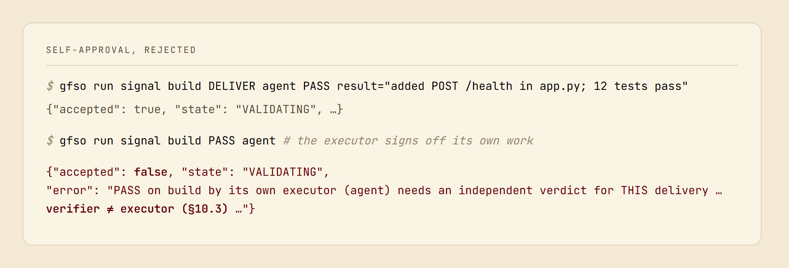

# GFSO: the theory

**Make a plan falsifiable — so when it fails, you know exactly which part was wrong.**

---

**A plan is usually an unfalsifiable story.** It fails, and no one can say which part was wrong — the estimate, the interface, a missed dependency, or the one subtask everyone assumed was trivial. The post-mortem argues. The plan offered nothing to check against.

GFSO turns a decomposition into **pre-registered, separately refutable claims** — every subtask a decidable pass/fail criterion with a named owner, every join between subtasks an explicit claim that *these children, together, make the parent*. Something breaks, and the structure points at the exact false claim and who made it — not at "the project."

Two properties carry that promise, and neither is a design choice you could tune away. (§ numbers refer to [the canon](applied_gfso_v4_en.md).)

**Failure localizes.** A split is correct when two things hold: the children passing secures every criterion of the parent (joint sufficiency), and no child can fail without failing one of the parent's criteria (non-redundancy). Under a correct split a parent passes exactly when every child passes: `V(parent) = AND(V(children))`. One false leaf cannot hide behind a green parent; the failure pins to the node whose claim broke, at any depth.

**A claim cannot pass on its author's word.** Your agent reports its task done; the engine does not take its word. At every **delegation seam** — and the result handed out of a scope is always one — the verdict is signed by the issuer, never by the executor, over a check that is not the executor's (§10.3), and the engine refuses a `PASS` until a separate validator has run every criterion against the real deliverable — here, live:

Self-approval is not discouraged. At a seam it is structurally impossible, and the one way a self-signed verdict comes to stand there, signed while the node was internal and made public later, is named (§16.9). Inside one scope an agent does check its own work — and stakes every bit of it a public delivery carries on the single public verdict at that scope's edge (§10.3).

---

## Why those two properties hold

GFSO is not a good design. It is **derived** from two axioms:

> **A1 (verifiability).** Any organized activity is directed at a goal whose attainment is checkable by a finite set of conditions, each decidable in finite time and returning pass or fail.
>
> **A2 (decomposability).** There exist goals whose complexity exceeds the capacity of a single agent; they are attainable only by splitting them into parts, each within the capacity of some agent.

What the axioms do not fix is written down rather than left implicit: three covering axioms carry the "there is no further kind" claims, and eleven design decisions are marked where they are made (§20.5).

**Why `AND`, and not a weighted score?** Non-redundancy already says that a failed child fails the parent. Enumerate the sixteen binary aggregations; require commutativity, associativity, that fail absorbs, and that the result not be constant. `AND` is the sole survivor (§7.2). A score that could outvote a failed necessary child would contradict what "necessary" means.

**Where exactly is the address?** The parent's verdict is not computed from its children; it is its own check over the delivered result, so the equality is something the run can contradict. Take a parent `the page lists the orders the database holds`, split into a backend child, `/orders returns them`, and a frontend child, `the page renders what /orders returns`:

- The backend's check fails. The address is that child and its failed criterion; the parent is not in question.
- Both children pass and the parent's own check sees an empty page. Take the verdicts as true, and what is refuted is the split's claim that those two were enough (a field name the two never agreed on, which nobody wrote): the address is whoever made the split (§8.7). A verdict that is itself untrue is the third failure mode below, with its own address, its validator.
- The parent also says `sorted by date`, and no child carries it. The split is refused before any work (§9.5).

**Why binary acceptance, and not a percentage?** Because A1 already says it: a criterion is a decidable predicate returning pass/fail, and a conjunction of two-valued things is two-valued — the scale is fixed by the axiom, with no appeal to what you do about it (§7.1). The familiar argument — a verdict that maps to no distinct action is not a verdict, so by pigeonhole the scale collapses to two — is the *defense* against a graded scale, not the source, and it rests on there being exactly two actions (a covering claim, not a theorem: finer granularity lives in the tree). There is no "80% done" to shelter in; "in progress" lives in the state machine, not the scale.

**Why trust that you've listed every way it can break?** A decomposition's failures are not collected from experience — they are a basis, complete modulo one covering axiom. Compositional validation is a computation, characterized on two orthogonal axes: the function it evaluates, and the process in time that evaluates it. Split each, and you get **six failure modes with no room for a seventh** (§8.2, §8.8):

| where | condition | when it breaks |
|---|---|---|
| the arguments | **FM-1 correspondence** | the children do not secure the parent, or demand more than it needs |
| | **FM-2 consistency** | no result can pass all the children's criteria |
| the values | **FM-3 veracity** | a verdict is untrue, a false pass or a false fail |
| the rule | **FM-4 propagation** | what is computed is not `AND` |
| before the run | **FM-6 feasibility** | the split was fixed before what decides it could be known |
| during the run | **FM-5 freshness** | what the split rests on changed under it |

A study of 216 public post-mortems found 0 that needed a seventh; what would refute the claim is written in [`falsifiability.md`](falsifiability.md) (§8.2).

**Why can't the agent just game the protocol?** A model with no payoffs does not need to be persuaded: the gate above refuses a self-signed `PASS` whatever the agent wants. For parties with interests, the protocol is minimal and incentive-compatible. One handoff runs as a peer-to-peer transaction over 12 signals and 11 states; remove any signal and a specific defect returns. Drop any incentive-critical rule and honesty stops being dominant for one named party (§11.4, §16.12). Where a deviation is detected and priced and p·cost(undetected defect) > cost(signal) — Prop 8's premise (§16.11) — and outside fifteen named exceptions (§16.9), honesty is made rational by the rules — not asked of people.

Two things then come for free. Quality is five rates read from the execution trace, one per primitive, so faking a metric by signals means faking the process; five named dials move a metric unpriced (§15.6). And every decision leaves a record by construction: the way double-entry bookkeeping structurally forbids an unbalanced ledger, GFSO forbids an unrecorded decision (§11.6).

---

## Where the guarantee stops

None of this proves your decomposition is *correct*. It proves only that the plan is checkable, and that failure localizes.

Whether these children truly compose into that parent in the real world, the framework cannot decide — by construction. Two domains with the same formal graph can obey different real laws (Lemma 1), so the axioms do not fix which decomposition is faithful, and no amount of declaring it so grounds it (Lemma 2). That knowledge comes only from contact with the domain.

That gap is where your agent — human or LLM — carries the weight. GFSO **derives** its necessity rather than assuming it: reliable domain knowledge cannot come from the apparatus, so an agent must supply it, and the exact thing it must supply is named (§3–4). A standard would stop at prescribing. This one also *explains* why competent work already succeeded — the agent carried enough tacit structure — and *predicts*, falsifiably, where the framework stops applying, and when one agent can be swapped for another (§4.6).

The framework names exactly what it guarantees and exactly what it hands to the agent.

The permanent boundaries are stated, not buried: a domain-silent false-`pass` cannot be caught a priori by any discipline (Lemma 1); the causal correctness of a decomposition is a characterized boundary, not an open algorithm; global uniqueness of the basis cannot be derived from inside (a named boundary). On the protocol side, requirements alone pin which exits must exist and not where they go; the machine's table is forced only over the log and relative to named decisions (§13.2–§13.6, §20.7).

---

## What it is, and is not

**Planning ⊂ GFSO.** Classical planning and control — STRIPS, MDPs, HTN, A\*, MPC, RL — enter as a single sub-step, rewritten in GFSO's own terms: search over the estimated structure is one link in a longer chain (§19.2). The new mechanics are a narrow delta.

The value is not novelty of mechanism. It is **making-explicit** — moving decomposition out of private intuition into one axiom-derived, checkable, faithfulness-graded discipline that holds at every level. That is what makes planning falsifiable (§19.3). Scrum, in turn, embeds in GFSO's structure with named restrictions and relaxations (§19.4).

**Its nearest neighbours each carry a part.** Contract-based design has assume/guarantee and postconditions at the level of a component. Goal-oriented requirements engineering (KAOS) has goal trees with refinements required to be complete, consistent and minimal, as artifacts of the specification. Assurance cases (GSN) have a structured argument that a claim holds, and safety standards such as DO-178 require independent verification. What GFSO adds is the transaction they leave unwritten: a runtime protocol with CHALLENGE and BLOCK, a record of every decision, a composition law with its correctness conditions, a failure basis, and metrics read off the same log (§19.8).

It is not a task tracker — Jira tracks tasks; GFSO tracks *decisions*: who split what, on what criteria, why. The definition on one page, with what it does and does not claim, is [`CORE.md`](CORE.md).

---

## What stands behind it

The two properties above are not a paper. They run: the [product page](../README.md) is the implementation and what it measures. The theory is stated in full; the empirical base is in progress.

**Theory.** Formal framework (6 theorems + 8 further results), the binary scale (sourced in A1) and the uniqueness of `AND` and the six-mode basis (complete modulo one named covering axiom), and a falsifiability register are in place. The canon is English (v4.1).

**What the canon leaves falls in three classes**, kept apart by a criterion the document states and applies entry by entry (§20.1): named boundaries — questions inside the theory whose closure it shows unavailable from inside (§20.8); the questions around it whose answers would change none of its claims, where it says it stops (§20.9); and requirements not yet built or measured (§20.10). Its every load-bearing claim carries what would refute it in [`falsifiability.md`](falsifiability.md); that register, not a roadmap, is what would reopen the canon.

**The formal spine** is a Lean 4 development on the language kernel — no mathlib, no `sorry` — that audits the axiomatic surface rather than standing in for the arguments: exactly three covering axioms carry the "no further kind" results inside it, every other postulate's placement is disclosed, and a fail-closed CI guard rejects any axiom outside a published whitelist and Lean's three foundations (§20.4; [`formal/README.md`](../formal/README.md)). Three TLA+ models are model-checked.

**Empirical.**
- **E0** — on 148 BCB-Hard tasks, explicit unit-test criteria raise Haiku 4.5's zero-shot solve rate from 29.1% to 63.5% — one attempt each, no rework loop; the spec-carrying prompt costs ×1.85 the tokens.
- **E1** — the failure-mode taxonomy against 216 public post-mortems: **0 / 216** need a mode outside it.
- **E2** — the search ↔ audit cycle raises coverage of a completeness-audited reference decomposition on 9 of 10 domains (74 → 81% average across ten diverse domains) and is productized as `auto_decompose`. Measured against a bare-built reference, this shows the cycle *converges* — not that the discipline itself pays off, which is **E3**.
- **E3** *(in part)* — the agent alone against the same model under GFSO's automatic mode, on explicit contracts with held-out suites, three tasks by three models, every row in [`RESULTS.md`](RESULTS.md). Alone the models said "done" 19 times and 6 of those deliveries scored 9–91%; on a given plan verified against the oracle, the same models closed 14 goals, none below 98.6%. With the system writing its own plan, the weakest model has no verdict on the counted builds. Long-horizon deployment, and how often a failure's address proves right in one, are not measured (§20.10).

Each of those is recorded run by run, with its own boundaries, in [`EVIDENCE_LOG.md`](EVIDENCE_LOG.md).

---

## Where to read on

- [`CORE.md`](CORE.md) — the definition on one page: what GFSO is and is not, what it claims and does not.
- [`applied_gfso_v4_en.md`](applied_gfso_v4_en.md) — the canon: the theory of directed action → axioms → theorems → protocol → metrics, the single source of truth.
- [`method_gfso.md`](method_gfso.md) — the canon distilled for an operator.
- [`falsifiability.md`](falsifiability.md) — each load-bearing claim typed by what would refute it.
- [`gfso_dependency_map.md`](gfso_dependency_map.md) — how the results derive from one another.
- [`formal/README.md`](../formal/README.md) — the Lean 4 audit: what is checked, what only modulo a named covering axiom, what is out of scope, and the code ↔ canon corners, with a per-result coverage table.
- [`EVIDENCE_LOG.md`](EVIDENCE_LOG.md) — every experiment, run by run, with its boundaries.
