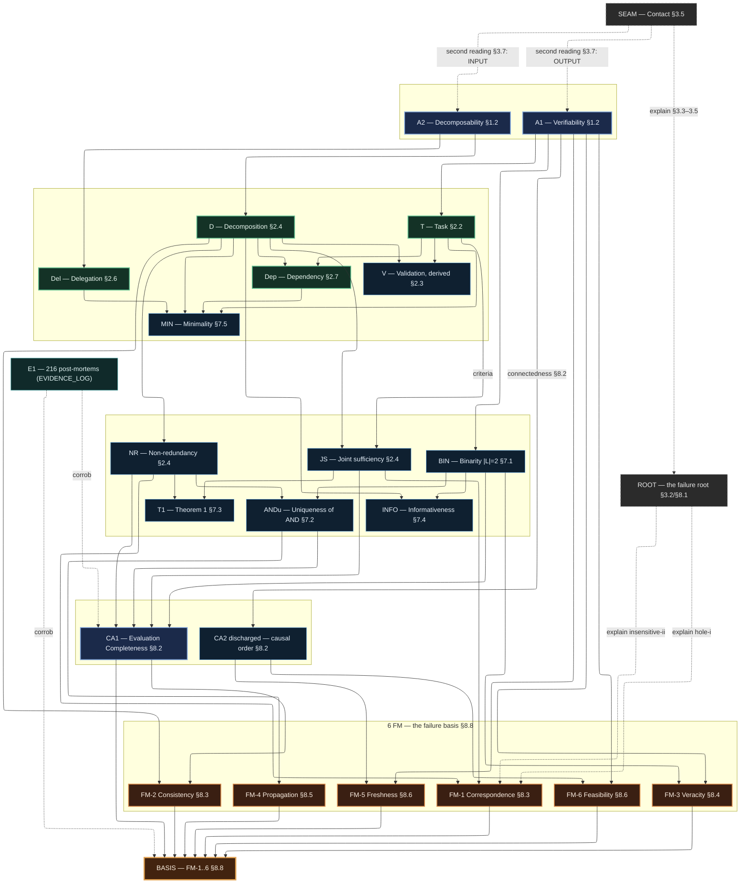
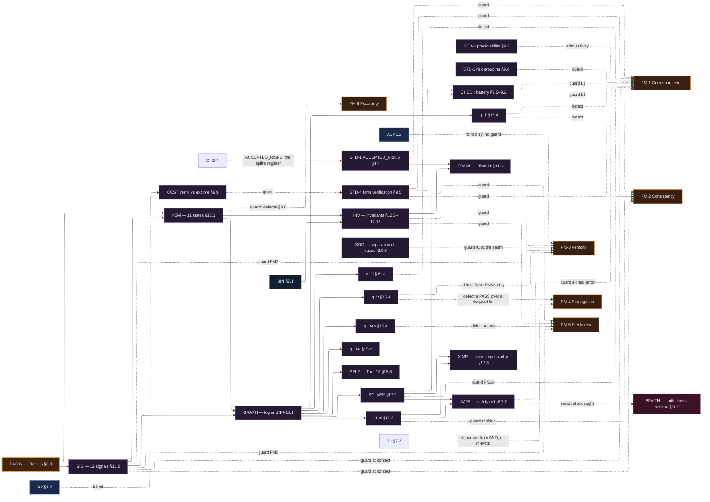
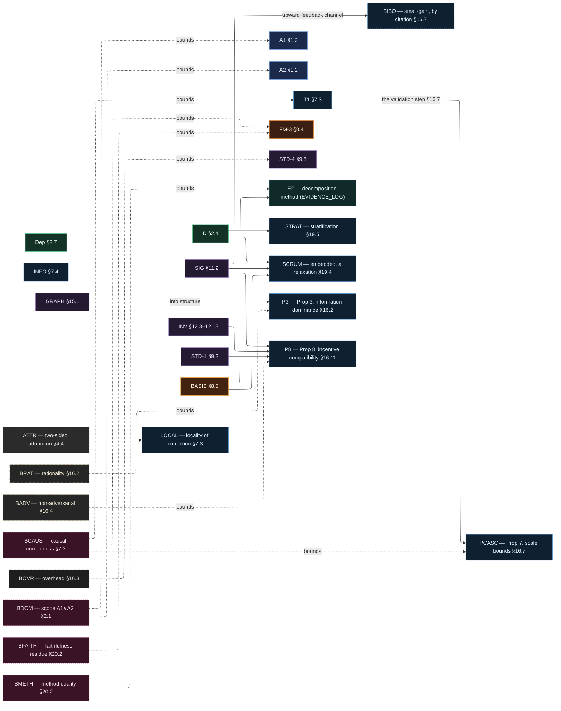
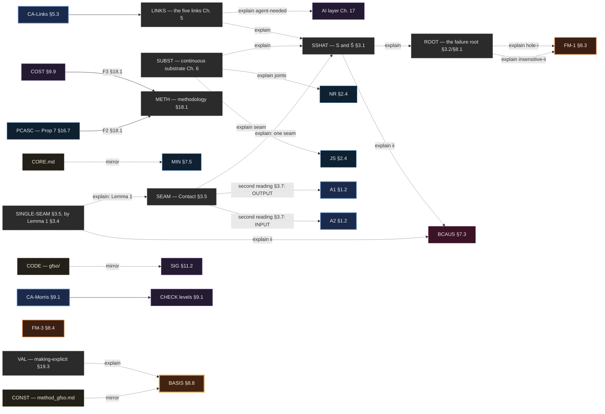

# GFSO — the dependency map

> What follows from what in the canon `applied_gfso_v4_en.md`. A solid arrow `A --> B` = "B is derived from /
> depends on A"; a dashed one is an auxiliary link labelled with its kind. Every node carries the § of its home;
> every edge is a claim of the canon, the nontrivial ones registered with their § in the Edge ledger at the bottom.
> The claims themselves live in the canon — the map draws only their dependencies.
>
> **The completeness spine (what the map exists for):** axioms → primitives → correctness (Ch. 2, 7) → Thm 1 (§7.3)
> → **CA1 (§8.2)** → **the 6 FM as a basis (§8.8)**, scoped by §8.10. It is one of the three closures of §20.5
> (CA1 · CA-Morris §9.1 · CA-Links §5.3); the map unfolds the first and carries the other two as nodes on View 4.
> The standards (Ch. 9), the protocol (Ch. 11–12), the metrics (§15.4) and the AI layer (Ch. 17) hang on specific
> FMs as **guards/detectors — not a source of completeness**.

## Edge legend

| Edge | Meaning |
|---|---|
| `A --> B` solid | B is **derived from / depends on** A (a load-bearing deduction of the canon) |
| `A -.->\|guard\| B` | a standard/invariant/axiom/protocol mechanism **guards** this FM (§9.10, Ch. 11–12) — not a source of completeness |
| `A -.->\|detect\| B` | a metric **catches** this FM at runtime (§15.4, §15.7) |
| `A -.->\|corrob\| B` | empirical corroboration (E1, `EVIDENCE_LOG`) |
| `A -.->\|explain\| B` | the theory-model (Ch. 3–6, §19.3) grounding the apparatus (§20.11); dashed because its edges do not re-prove T1 / the 6 FM / minimality |
| `A -.->\|second reading\| B` | §3.7: "The reading adds to the axioms, postulates still, the role of interface conditions of Contact, without deriving them" — dashed on purpose: a solid arrow into A1/A2 would assert the derivation §3.7 denies |
| `A -.->\|bounds\| B` | a premise (§20.5), boundary (§20.8) or around-the-theory node (§20.9) limiting B |
| `A -.->\|mirror\| B` | a projection of the canon — a rendering, not a new primitive |

> **Direction.** The `explain` edges run one-way, from the theory-model into the apparatus (§20.11's logical map).
> METH alone takes edges in from the apparatus: §18.1's mechanisms are forced by (F2) in Prop 7's model and (F3) `c_check`
> graded by level (Ch. 9).

> The map is split into **4 focus views** (each readable on its own; a node/edge may repeat across views — that is
> deliberate). The full graph is at the bottom, under a spoiler. The classDef styles are shared by all views.

---

## View 1 — THE COMPLETENESS SPINE (hero)

*What it shows: axioms → primitives → correctness → CA1 → 6 FM → basis; E1 corroborates; the failure root's integration cases explain FM-1; the seam's second reading of the axioms.*

---

## View 2 — GUARDS AND DETECTORS

*What it shows: the 6 FM as anchors, with the standards (Ch. 9), the protocol (Ch. 11–12), the metrics (§15.4) and the AI layer (Ch. 17) hung on them — guards and runtime detectors, built out of BASIS.*

---

## View 3 — THE CH. 16 RESULTS AND THE BOUNDARIES

*What it shows: the load-bearing results of Ch. 16 (Prop 3, Prop 8, Prop 7), the derivatives (stratification, Scrum), and the premise / boundary / around nodes tied to exactly what each bounds.*

---

## View 4 — THE THEORY-MODEL FOUNDATION + MIRRORS

*What it shows: the theory-model (dashed `explain` = grounding), the single contact seam, the two other covering axioms, and the canon's mirrors (`mirror`); no re-proof of T1 / the 6 FM / minimality happens here.*

## How to read it (the key chains)

Each chain names its view, its nodes and where the canon states it; the claims are read there.

- **The completeness spine** (View 1): the 6 FM complete as a basis modulo CA1 (§8.2, §8.8), scope §8.10; CA2's
  discharge §8.2, §20.5. One of three closures (§20.5); E1 corroborates (`EVIDENCE_LOG`). Everything below BASIS is
  implementation, not a source of completeness.
- **The single seam** (Views 1, 4): Lemma 1 (§3.4), Contact and SINGLE-SEAM (§3.5), the second reading (§3.7).
  The `second reading` edges stay dashed (legend).
- **The two axes** (View 1): denotational FM-1–FM-4 (§8.3–8.5), operational FM-6, FM-5, none after (§8.6); geometry
  §8.10.
- **The standards** (View 2): the guard table §9.10 — which FMs have a structural guard and which none.
- **The protocol** (View 2): why these twelve and their 4/4/3/1 typing, §11.4; FSM §12.1; invariants §12.3–12.13;
  separation of duties at the seam §10.3.
- **The metrics** (View 2): what each q senses, §15.4 and §15.7; limits §15.8; Thm 10 §15.6; Thm 11 §11.6.
- **The AI layer** (View 2): §17.2–17.4, safety net §17.7, who is who §17.8.
- **The derivatives** (View 3): stratification §19.5 (its premises steps 2–5); Scrum §19.4.
- **The Ch. 16 results** (View 3): Prop 3 §16.2, Prop 8 §16.8–16.12, Prop 7 §16.7. The map's own drawing choices:
  - no `INFO → P3` edge — §16.2's proof runs on the projection kernel and does not cite §7.4; Inf-B (§7.4) is
    Blackwell against binarity, not an input to Prop 3;
  - `T1 → PCASC` solid and BCAUS bounding PCASC — "Thm 1 and what rests on it — Prop 7 … — are conditional on
    the correctness of D" (§16.7); γ is defined there;
  - BIBO is a separate `cited` node — §16.7 holds it by citation, about the feedback channel, not as Prop 7's
    condition;
  - LOCAL hangs on ATTR, not on PCASC — §7.3, §18.2.
- **The bounds** (View 3): BRAT and BADV are premises (`premise` class, §20.5), BOVR is around the theory (§20.9),
  the rest boundaries (§20.2, §20.8; BDOM §2.1, §16.17). The uniqueness of the basis and of the protocol sits at the
  carve wall (§20.7; BWALL in the full graph); the protocol's forcing over the log is §13.4.
- **The theory-model** (View 4): the foundation (§20.11); its integration cases §8.7; the agent's necessity §4.1
  against the AI layer's capacity §17.8; METH fed by COST and PCASC (§18.1).
- **The mirrors** (View 4): projections of the canon; the code's names, `architecture.md`.
- **E2** (View 3): the experiment in `EVIDENCE_LOG`; the generation method §19.3; the value's open measurement §20.10.

## Edge ledger (the grounding — for the critic)

> The obvious spine edges (A1→T, JS→T1, FM-i→BASIS etc.) are omitted — they are Ch. 1–8 verbatim.
> Below: the nontrivial / added edges, each with its § and the claim it rests on, named or quoted.

| Edge | § | Grounding |
|---|---|---|
| SEAM -.explain.-> SSHAT | §3.5 / §11.4 | "Contact is the one operation that reads S" |
| SINGLE -.explain.-> SEAM | §3.3–3.5 | SINGLE-SEAM, Lemma 1 |
| SEAM -.second reading.-> A1 | §3.7 | "A1 is the solvability of Contact's output." — a role added, not a derivation (legend) |
| SEAM -.second reading.-> A2 | §3.7 | "A2 is the constructibility of Contact's input." — same status |
| SINGLE -.explain ii.-> BCAUS | §3.5 / §20.2 | causal correctness a permanent boundary (Lemma 1) |
| AXM → CHK | §9.1 / §20.5 | CA-Morris yields the three verification levels |
| AXL → LINKS | §5.3 / §20.5 | CA-Links yields the five links |
| ~~A1 → STRAT~~ **(removed)** | §19.5 step 2 | concreteness is a premise: "A1 bounds the time a check takes, not how abstract its predicate is" |
| D → STRAT | §19.5 step 1 | deadline coherence along D |
| BIN → INFO, D → INFO | §7.4 | Inf-A |
| D → STD1 (ACCEPTED_RISKS) | §9.2 | STD-1, the register "the split's attribute"; "a register carried in the task's own fields … is task data, not the split's register" |
| STD1/STD2/STD3 -.guard.-> FM1 | §9.10 / §9.3 | STD-1/3 coverage standards on FM-1's joint-sufficiency clause; "STD-2 is an admissibility criterion for omission" |
| STD4 -.guard.-> FM-1, FM-2, FM-5 | §9.5 / §9.10 | "FM-1, FM-2 and FM-5 have structural guards" |
| FSM -.guard.-> FM6 | §8.6 / §11.4 / §16.17 | FM-6's remedy "Defer the split until contact has made it definable"; a split's denial reaches its decomposer, §11.4 (ii) |
| CHK -.guard L1.-> FM1, FM2 | §9.6 / §9.10 | CHECK-7 → FM-1.d apparatus face; CHECK-8 → FM-2 |
| COST -.guard.-> STD4 | §9.9 | verify vs explore |
| A1 -.form only, no guard.-> FM3 | §8.4 / §9.10 / §15.7 | "no structural CHECK guards FM-3" |
| T1 -.no CHECK.-> FM4 | §9.10 / §12.8 / §15.7 | FM-4's departure from AND read off the log |
| Q/𝒢 → TRIAGE (not drawn) | §15.9 | triage order, a heuristic under its premise |
| BASIS → SIG, BASIS → FSM | §11.4 | the protocol derived through the failure modes to the signals |
| SIG -.guard.-> FM1/FM2 | §11.4 | CHALLENGE's row (FM-1/2) |
| SIG -.guard FM5.-> FM5 | §11.4 / §15.7 | BLOCK's and CANCEL's rows (FM-5) |
| SIG -.guard FM3.-> FM3 | §11.4 | FAIL's row (FM-3) |
| BIN → INV, FSM → INV | §12.8 / §12.4 / §12.12 | Inv-2 from binarity; Inv-6, Inv-5 over the machine |
| INV -.guard.-> FM3 | §12.8 | Inv-3, failure transparency |
| INV -.guard.-> FM5 | §12.3 / §15.7 | Inv-1 |
| SOD -.guard IC.-> FM3 | §10.3 / §16.13 | at a public node "the verdict is signed independently, over a check that is not the executor's" |
| SIG → GRAPH, FSM → GRAPH | §15.1 | the task graph |
| GRAPH → q_* | §15.4 / §15.6 | Q, Thm 10 |
| QT/QD -.detect.-> FM1 (QT → FM2) | §15.4 / §15.7 | q_T: "the spec defects CHALLENGE reports"; q_D: "the pattern a composition claim refuted at contact leaves, whatever caused it"; "FM-1 is guarded at runtime by CHALLENGE (counted by q_T) and q_D" |
| QV -.detect.-> FM3, FM4 | §15.4 / §15.7 | "q_V reads every PASS a later fail finds, whatever made it untrue" — the two edges drawn are FM-3's false PASS and FM-4's dropped fail |
| QDEP -.detect.-> FM5 | §15.7 | "q_Dep reads the undeclared couplings BLOCKs name, an FM-5 race among them" |
| QDEL (no FM edge) | §15.4 | "q_Del answers none of the six modes" |
| GRAPH → SELF | §15.6 | Thm 10, Cor 1 |
| INV → TRANS, STD1 → TRANS | §11.6 | Thm 11 |
| GRAPH → SOLVER, GRAPH → LLM | §17.1–17.2 | necessity from capacity |
| SOLVER → CHK | §17.2 | the Solver runs CHECK-7 and CHECK-8 |
| SOLVER -.guard FM1d.-> FM1 | §9.10 / §17.2 | CHECK-7 on FM-1.d's apparatus face |
| LLM -.guard residual.-> FM2 | §17.2–17.4 | semantic consistency, reported by CHALLENGE |
| SOLVER+LLM → XIMP | §17.3 | cross-impossibility |
| SAFE -.guard signed-error.-> FM1 | §17.7 | "An LLM error with a formal signature is caught by the protocol" |
| SAFE -.residual uncaught.-> BFAITH | §17.7 / §20.2 | integration cases (i) and (ii) not caught by the apparatus |
| SIG/D/BASIS → SCRUM | §19.4 | Scrum embedded, a relaxation |
| GRAPH →\|info structure\| P3 | §16.1–16.2 | ℐ(α), the projection garbling |
| ~~INFO → P3~~ **(removed)** | §7.4 / §16.2 | **the canon does not run this edge** (How to read, Ch. 16) |
| SIG → P8, INV → P8, STD1 → P8 | §16.10–16.12 | the rows of §16.10; the IC-critical features of §16.12 |
| T1 → PCASC (the validation step) | §16.7 | "Thm 1 and what rests on it — Prop 7 …"; γ and Prop 7's premises defined there, γ = 1 where no criterion reveals the wall (§18.2) |
| SIG →\|upward feedback channel\| BIBO | §16.7 | "CHALLENGE and BLOCK form upward feedback, BIBO-stable by the small-gain theorem" (by citation) |
| ATTR → LOCAL | §7.3 | "Locality of correction — a correct upper node survives — follows from composition together with attribution" |
| A2 -.latent.-> COST | §1.4 / §9.9 | A2 as a capacity cost |
| AX1 → FM2, D → FM2 | §8.3 / §8.2 | FM-2's compatibility condition on the children's criteria, its grounding "belongs to CA1" (§8.3); no Dep → FM2: Dep is "a separate primitive" (§8.2), an omitted Dep coupling routed by §8.6 |
| BRAT -.bounds.-> P3 | §16.2 / §20.5 | "Blackwell dominance presumes it" — a premise |
| BADV -.bounds.-> P8 | §16.4 / §16.15 / §20.9 | a premise; the threat model |
| BCAUS -.bounds.-> T1, FM3, PCASC | §7.3 / §16.7 / §20.2 | Thm 1 "holds given a correct decomposition and does not produce one"; Prop 7 rests on Thm 1, "conditional on the correctness of D" (§16.7) |
| BOVR -.bounds.-> STD4 | §16.3 / §20.9 | around the theory |
| BDOM -.bounds.-> A1, A2 | §2.1 / §16.17 | "The model is needed iff A1 ∧ A2" |
| BFAITH -.bounds.-> FM3 | §3.5 / §20.2 | the faithfulness residue |
| BMETH -.bounds.-> E2 | §20.2 / `EVIDENCE_LOG` | the faithfulness half of method quality, left to measurement (§20.8) |
| ROOT -.explain hole-i.-> FM1 | §8.7 (i) | coverage hole — FM-1.f |
| ROOT -.explain insensitive-ii.-> FM1 | §8.7 (ii) / §8.4 | insensitive edge — FM-1.d's domain face; its false PASS FM-3's |
| SSHAT -.explain.-> ROOT | §3.2 | faithfulness and failure |
| SUBST -.explain joints.-> NR | §6.7 | "Non-redundancy (Ch. 2) is the discrete shadow of separator-hood" |
| SUBST -.explain seam.-> JS | §6.5 / §7.3 | AND-soundness |
| LINKS -.explain agent-needed.-> AI | §4.1 / §17.8 | agent necessity vs the AI layer's capacity |
| COST → METH, PCASC → METH | §18.1 | the two mechanisms forced by "(F2) error compounds down the tree, multiplicatively in Prop 7's model" and "(F3) … `c_check`, graded by level (Ch. 9)"; Mechanism 1 runs "to the level verify-vs-explore sets" |
| VAL -.explain.-> BASIS | §19.3 | value = making-explicit |
| SSHAT -.explain ii.-> BCAUS | §3.2 / §20.2 | clause (ii), causal correctness |
| CONST/CORE/CODE -.mirror.-> the canon | — | projections; the code's names, `architecture.md` |

```mermaid
flowchart TD
  classDef axiom fill:#1b2a4a,stroke:#7da2d9,color:#eaf0fb,stroke-width:2px;
  classDef prim fill:#143226,stroke:#5fbf8f,color:#e9f7ef,stroke-width:2px;
  classDef derived fill:#0f2030,stroke:#5b9bd5,color:#e6f0fa;
  classDef fm fill:#3a1f12,stroke:#d98a4a,color:#fbeee2,stroke-width:2px;
  classDef basis fill:#42230f,stroke:#e0a050,color:#fdf1e2,stroke-width:3px;
  classDef guard fill:#241a32,stroke:#9b7fc4,color:#efe9f7;
  classDef ground fill:#2b2b2b,stroke:#8a8a8a,color:#e8e8e8,stroke-dasharray:5 4;
  classDef emp fill:#102a2a,stroke:#4fb0b0,color:#e3f5f5;
  classDef bound fill:#3a1326,stroke:#c46a93,color:#f6e3ec,stroke-dasharray:3 3;
  classDef premise fill:#262626,stroke:#b0a07a,color:#efe8d6,stroke-dasharray:2 2;
  classDef around fill:#1e1e1e,stroke:#7a7a7a,color:#dcdcdc,stroke-dasharray:1 3;
  classDef mirror fill:#222018,stroke:#9a8f5a,color:#f1edda,stroke-dasharray:2 3;
  classDef cited fill:#0f2030,stroke:#5b9bd5,color:#e6f0fa,stroke-dasharray:4 2;

  subgraph AX["Axioms §1.2"]
    A1["A1 — Verifiability §1.2"]
    A2["A2 — Decomposability §1.2"]
  end
  class A1,A2 axiom

  subgraph PR["Primitives Ch. 2, §7.5"]
    T["T — Task §2.2"]
    D["D — Decomposition §2.4"]
    Del["Del — Delegation §2.6"]
    Dep["Dep — Dependency §2.7"]
    V["V — Validation, derived §2.3"]
    MIN["MIN — basis minimality §7.5"]
  end
  class T,D,Del,Dep prim
  class V derived
  class MIN derived

  subgraph CMP["Correctness and composition Ch. 2, 7"]
    JS["JS — Joint sufficiency §2.4"]
    NR["NR — Non-redundancy §2.4"]
    BIN["BIN — Binarity |L|=2 §7.1"]
    ANDu["ANDu — Uniqueness of AND §7.2"]
    T1["T1 — Theorem 1 §7.3"]
    INFO["INFO — Informativeness §7.4"]
  end
  class JS,NR,BIN,ANDu,T1,INFO derived

  subgraph COV["Covering axioms §20.5"]
    AX1["CA1 — Evaluation Completeness §8.2"]
    AX2["CA2 discharged — causal order §8.2"]
    AXM["CA-Morris §9.1"]
    AXL["CA-Links §5.3"]
  end
  class AX1,AXM,AXL axiom
  class AX2 derived

  subgraph FMS["Failure modes — denotational §8.3–8.5"]
    FM1["FM-1 Correspondence §8.3"]
    FM2["FM-2 Consistency §8.3"]
    FM3["FM-3 Veracity §8.4"]
    FM4["FM-4 Propagation §8.5"]
  end
  subgraph FMO["Failure modes — operational §8.6"]
    FM6["FM-6 Feasibility §8.6"]
    FM5["FM-5 Freshness §8.6"]
  end
  class FM1,FM2,FM3,FM4,FM5,FM6 fm

  BASIS["BASIS — FM-1..6 §8.8"]
  class BASIS basis

  ROOT["ROOT — the failure root §3.2/§8.1"]
  SEAM["SEAM — Contact §3.5"]
  SINGLE["SINGLE-SEAM §3.5, by Lemma 1 §3.4"]
  class ROOT,SEAM,SINGLE ground

  subgraph STD["Standards and checks Ch. 9"]
    STD1["STD-1 ACCEPTED_RISKS §9.2"]
    STD2["STD-2 predictability §9.3"]
    STD3["STD-3 risk grouping §9.4"]
    STD4["STD-4 form verification §9.5"]
    CHK["CHECK battery §9.5–9.6"]
    COST["COST verify vs explore §9.9"]
  end
  class STD1,STD2,STD3,STD4,CHK,COST guard

  subgraph PROTO["Protocol Ch. 10–12"]
    SIG["SIG — 12 signals §11.2"]
    FSM["FSM — 11 states §12.1"]
    INV["INV — invariants §12.3–12.13"]
    SOD["SOD — separation of duties §10.3"]
  end
  class SIG,FSM,INV,SOD guard

  subgraph MET["Metrics and transparency Ch. 15, §11.6"]
    GRAPH["GRAPH — log and 𝒢 §15.1"]
    QT["q_T §15.4"]
    QD["q_D §15.4"]
    QV["q_V §15.4"]
    QDEP["q_Dep §15.4"]
    QDEL["q_Del §15.4"]
    SELF["SELF — Thm 10 §15.6"]
    TRANS["TRANS — Thm 11 §11.6"]
  end
  class GRAPH,QT,QD,QV,QDEP,QDEL,SELF,TRANS guard

  subgraph AI["AI layer Ch. 17"]
    SOLVER["SOLVER §17.2"]
    LLM["LLM §17.2"]
    XIMP["XIMP — cross-impossibility §17.3"]
    SAFE["SAFE — safety net §17.7"]
  end
  class SOLVER,LLM,XIMP,SAFE guard

  subgraph DER["Derivative results Ch. 19"]
    STRAT["STRAT — stratification §19.5"]
    SCRUM["SCRUM — embedded, a relaxation §19.4"]
  end
  class STRAT,SCRUM derived

  subgraph RES["Ch. 16 results"]
    P3["P3 — Prop 3, information dominance §16.2"]
    P8["P8 — Prop 8, incentive compatibility §16.11"]
    PCASC["PCASC — Prop 7, scale bounds §16.7"]
    BIBO["BIBO — small-gain, by citation §16.7"]
    LOCAL["LOCAL — locality of correction §7.3"]
  end
  class P3,P8,PCASC,LOCAL derived
  class BIBO cited

  subgraph BND["Premises, boundaries, around §20.5, §20.8, §20.9"]
    BRAT["BRAT — rationality §16.2"]
    BADV["BADV — non-adversarial §16.4"]
    BCAUS["BCAUS — causal correctness §7.3"]
    BOVR["BOVR — overhead §16.3"]
    BDOM["BDOM — scope A1∧A2 §2.1"]
    BFAITH["BFAITH — faithfulness residue §20.2"]
    BMETH["BMETH — method quality §20.2"]
    BWALL["BWALL — carve wall §20.7"]
  end
  class BCAUS,BDOM,BFAITH,BMETH,BWALL bound
  class BRAT,BADV premise
  class BOVR around

  subgraph TM["Theory-model — the foundation §20.11"]
    SSHAT["SSHAT — S and Ŝ §3.1"]
    SUBST["SUBST — continuous substrate Ch. 6"]
    LINKS["LINKS — the five links Ch. 5"]
    METH["METH — methodology §18.1"]
    VAL["VAL — making-explicit §19.3"]
    ATTR["ATTR — two-sided attribution §4.4"]
  end
  class SSHAT,SUBST,LINKS,METH,VAL,ATTR ground

  subgraph EXP["Empirics"]
    E1["E1 — 216 post-mortems (EVIDENCE_LOG)"]
    E2["E2 — decomposition method (EVIDENCE_LOG)"]
  end
  class E1,E2 emp

  subgraph MIR["Canon mirrors"]
    CONST["CONST — method_gfso.md"]
    CORE["CORE.md"]
    CODE["CODE — gfso/"]
  end
  class CONST,CORE,CODE mirror

  %% --- axioms → primitives ---
  A1 --> T
  T --> V
  A2 --> D
  A2 --> Del
  T --> Dep
  D --> Dep
  D --> V
  T --> MIN
  D --> MIN
  Dep --> MIN
  Del --> MIN

  %% --- primitives → correctness/composition ---
  T -->|criteria| JS
  D --> JS
  D --> NR
  A1 --> BIN
  BIN --> ANDu
  NR --> ANDu
  JS --> T1
  NR --> T1
  BIN --> INFO
  D --> INFO

  %% --- what grounds the covering axiom ---
  JS --> AX1
  NR --> AX1
  BIN --> AX1
  ANDu --> AX1
  A1 -->|connectedness §8.2| AX2

  %% --- the other two closures ---
  AXM --> CHK
  AXL --> LINKS

  %% --- each FM derived from its upstream result ---
  JS --> FM1
  NR --> FM1
  AX1 --> FM2
  D --> FM2
  BIN --> FM3
  A1 --> FM3
  ANDu --> FM4
  A1 --> FM6
  A1 --> FM5
  AX2 --> FM5
  AX2 --> FM6

  %% --- the 6 FM form a proved basis ---
  AX1 --> BASIS
  FM1 --> BASIS
  FM2 --> BASIS
  FM3 --> BASIS
  FM4 --> BASIS
  FM5 --> BASIS
  FM6 --> BASIS

  %% --- E1 corroborates the covering axiom ---
  E1 -.->|corrob| AX1
  E1 -.->|corrob| BASIS

  %% --- standards = guards of specific FMs (§9.10) ---
  D -.->|ACCEPTED_RISKS, the split's register| STD1
  STD1 -.->|guard| FM1
  STD2 -.->|admissibility| FM1
  STD3 -.->|guard| FM1
  STD4 -.->|guard| FM1
  STD4 -.->|guard| FM2
  T1 -.->|departure from AND, no CHECK| FM4
  STD4 -.->|guard| FM5
  A1 -.->|form only, no guard| FM3
  STD4 --> CHK
  CHK -.->|guard L1| FM1
  CHK -.->|guard L1| FM2
  COST -.->|guard| STD4
  A2 -.->|latent| COST

  %% --- protocol: BASIS builds the signals (§11.4) ---
  BASIS --> SIG
  BASIS --> FSM
  SIG --> FSM
  SIG -.->|guard at contact| FM1
  SIG -.->|guard at contact| FM2
  SIG -.->|guard FM5| FM5
  SIG -.->|guard FM3| FM3
  FSM -.->|guard: deferral §8.6| FM6
  INV -.->|guard| FM3
  INV -.->|guard| FM5
  BIN --> INV
  FSM --> INV
  SOD -.->|guard IC at the seam| FM3

  %% --- metrics: the graph from the protocol, the q's detect FMs (§15.4, §15.7) ---
  SIG --> GRAPH
  FSM --> GRAPH
  GRAPH --> QT
  GRAPH --> QD
  GRAPH --> QV
  GRAPH --> QDEP
  GRAPH --> QDEL
  QT -.->|detect| FM1
  QT -.->|detect| FM2
  QD -.->|detect| FM1
  QV -.->|detect false-PASS only| FM3
  QV -.->|detect a PASS over a dropped fail| FM4
  QDEP -.->|detect a race| FM5
  GRAPH --> SELF
  INV --> TRANS
  STD1 --> TRANS

  %% --- AI layer: guards of the residual FMs (Ch. 17) ---
  GRAPH --> SOLVER
  GRAPH --> LLM
  SOLVER --> CHK
  SOLVER -.->|guard FM1d| FM1
  LLM -.->|guard residual| FM2
  SOLVER --> XIMP
  LLM --> XIMP
  SOLVER --> SAFE
  LLM --> SAFE
  SAFE -.->|guard signed-error| FM1
  SAFE -.->|residual uncaught| BFAITH

  %% --- derivative results ---
  D --> STRAT
  SIG --> SCRUM
  D --> SCRUM
  BASIS --> SCRUM

  %% --- Ch. 16 results ---
  GRAPH -->|info structure| P3
  SIG --> P8
  INV --> P8
  STD1 --> P8
  T1 -->|the validation step §16.7| PCASC
  SIG -->|upward feedback channel| BIBO
  ATTR --> LOCAL

  %% --- boundaries hung on what they bound ---
  BRAT -.->|bounds| P3
  BADV -.->|bounds| P8
  BCAUS -.->|bounds| T1
  BCAUS -.->|bounds| FM3
  BCAUS -.->|bounds| PCASC
  BOVR -.->|bounds| STD4
  BDOM -.->|bounds| A1
  BDOM -.->|bounds| A2
  BFAITH -.->|bounds| FM3
  BMETH -.->|bounds| E2

  %% --- the seam: the single place S enters; the second reading of the axioms (§3.7) ---
  SEAM -.->|explain: one seam| SSHAT
  SINGLE -.->|explain: Lemma 1| SEAM
  SEAM -.->|second reading §3.7: OUTPUT| A1
  SEAM -.->|second reading §3.7: INPUT| A2
  SINGLE -.->|explain ii| BCAUS

  %% --- the theory-model = the FOUNDATION (§20.11) ---
  ROOT -.->|explain hole-i| FM1
  ROOT -.->|explain insensitive-ii| FM1
  SSHAT -.->|explain| ROOT
  SUBST -.->|explain| SSHAT
  SUBST -.->|explain joints| NR
  SUBST -.->|explain seam| JS
  LINKS -.->|explain agent-needed| AI
  LINKS -.->|explain| SSHAT
  COST -->|F3 §18.1| METH
  PCASC -->|F2 §18.1| METH
  VAL -.->|explain| BASIS
  SSHAT -.->|explain ii| BCAUS

  %% --- E2 takes the 6 FM as the reference's completeness frame ---
  BASIS --> E2

  %% --- mirrors: projections of the canon ---
  CONST -.->|mirror| BASIS
  CORE -.->|mirror| MIN
  CODE -.->|mirror| SIG
```

The full graph (for zooming)

